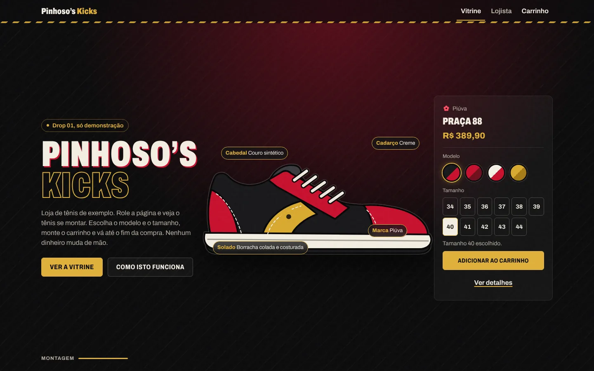

# Pinhoso’s Kicks



Fiz esta loja virtual de demonstração. **Pinhoso’s Kicks é um nome fictício, e todas as marcas, modelos, preços, estoques e pedidos foram inventados.** Nada aqui está à venda e nenhum pagamento é feito.

Publicada em: <https://toshiro01001.github.io/tenis-primeiro/>

## O que tem

- **Vitrine:** tênis em cima da própria caixa, com busca, filtros (categoria, tamanho, faixa de preço, marca) e ordenação. Os filtros ficam no endereço, então uma busca pode ser enviada por link.
- **Página de produto:** rota por hash (`#/produto/praca-88`), escolha de tamanho e quantidade limitada ao estoque daquele tamanho.
- **Carrinho:** salvo no navegador, com o cupom de exemplo `DEMO10` (10% nos produtos).
- **Checkout simulado em 4 etapas:** dados, entrega, pagamento e revisão, com validação de cada campo. Só o cartão de teste `4242 4242 4242 4242` é aceito.
- **Resumo do pedido:** desenhado como etiqueta de expedição.
- **Área do lojista:** pedidos simulados, situação de cada pedido e edição do estoque por tamanho. Tem um botão para restaurar os dados de exemplo.
- **Como isto funciona:** botão na abertura e no rodapé com a explicação para quem não é técnico.

## Como funciona

É uma página só (`index.html`). O JavaScript lê o que vem depois do `#` no endereço e desenha a tela certa dentro de `<main>`, sem recarregar e sem precisar de configuração no servidor. Por isso funciona em hospedagem estática como o GitHub Pages.

O catálogo é uma lista de dados em `js/dados.js`. Carrinho, cupom, estoque e pedidos ficam no `localStorage` do navegador. Se o `localStorage` estiver bloqueado ou com dado corrompido, a loja continua funcionando e ignora o que for inválido.

Os preços são guardados em centavos (inteiros), para não haver erro de arredondamento. O CPF e o cartão têm os dígitos verificadores calculados de verdade, e as máscaras formatam enquanto se digita.

Os tênis são desenhos originais em SVG, gerados por código em `js/tenis-svg.js`: cinco silhuetas e uma paleta de cores por modelo.

### Segurança e privacidade

- A política de segurança (CSP, na `<meta>` do `index.html`) só permite arquivos do próprio site e proíbe conexões e envio de formulários (`connect-src 'none'`, `form-action 'none'`). A página não tem como mandar dados para fora.
- Todo texto entra na tela por `textContent`, nunca por `innerHTML`.
- CPF, e-mail, endereço e cartão ficam só na memória enquanto a compra está aberta. O pedido salvo guarda apenas nome, cidade e UF.

### Organização dos arquivos

```
index.html            estrutura fixa: topo, rodapé e o diálogo "Como isto funciona"
css/base.css          fonte, cores e tipografia
css/componentes.css   botões, caixa de tênis, campos, diálogo
css/telas.css         disposição de cada tela
js/app.js             roteador
js/dados.js           catálogo, cupons, opções de entrega
js/estado.js          carrinho, estoque, pedidos e localStorage
js/validacao.js       regras e máscaras dos campos
js/tenis-svg.js       ilustrações dos tênis
js/dom.js             ajudantes para montar a tela com segurança
js/componentes.js     peças usadas em mais de uma tela
js/telas/             uma tela por arquivo
assets/               ícone e fonte
tests/                teste de ponta a ponta
```

## Como rodar

Precisa de um servidor local, porque módulos JavaScript não abrem direto do arquivo:

```bash
python3 -m http.server 8000
```

Depois abra <http://localhost:8000>. Não há instalação nem etapa de build.

## Testes

O teste percorre os fluxos reais em 1366x800, iPhone 13 e 320 px, e confere console limpo, ausência de rolagem lateral, estoque, validações e armazenamento bloqueado. Usa Playwright com Chromium instalados de forma global:

```bash
NODE_PATH=$(npm root -g) node tests/fluxos.test.cjs
```

## Tecnologias

HTML, CSS e JavaScript puros (módulos ES), SVG, `localStorage`. Sem framework, sem build e sem CDN. A fonte é a [Archivo](https://github.com/Omnibus-Type/Archivo), licença SIL Open Font (`assets/fontes/OFL.txt`), servida do próprio repositório.

## O que uma loja real precisaria a mais

Servidor e banco de dados, login do lojista, intermediador de pagamento (Pix e cartão de verdade), cálculo de frete, nota fiscal e política de privacidade.

---

Demonstração feita por [Mil e Uma Linhas!](https://mileumalinhas.com.br)

Desenvolvi este projeto e usei o Claude, da Anthropic, como ferramenta durante o desenvolvimento.
